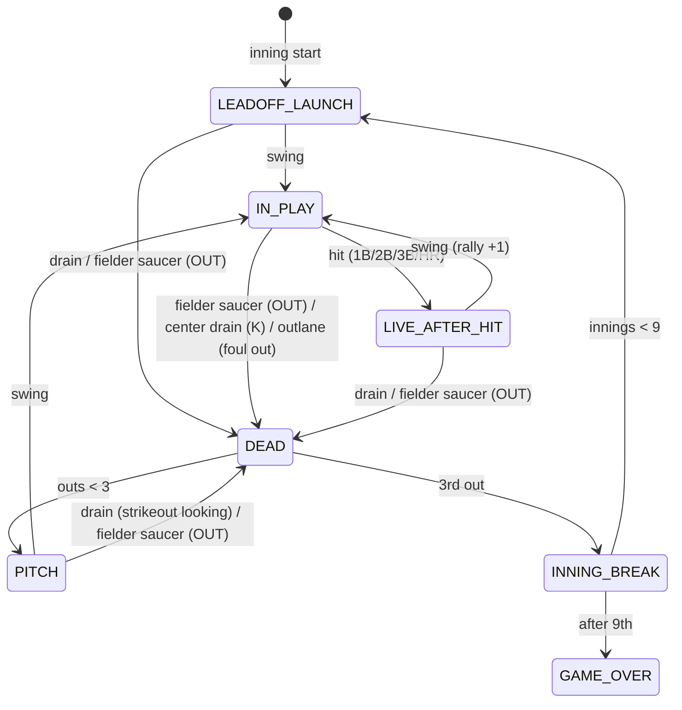

# 01 — Game Design

## 1. Pitch

A full-blooded pinball machine — orbits, ramps, a pop-bumper nest, drop targets — where the scoring
is baseball. The pitcher's mound serves up the ball; the flippers are the bat. Seven fielders guard
the gaps between the shots: miss your shot and they catch it for an out. Make it and you hit a single,
double, triple or a home run over the wall, runners sprint around the basepaths under the glass, and
the crowd roars. Nine innings, three outs each. Score as many runs as you can.

## 2. Design pillars

1. **The ball feels real.** Physics comes first. If a shot feels wrong, nothing else matters.
2. **Baseball you can read at a glance.** Outs, bases, inning and runs are always visible. Every
   outcome is unambiguous and announced.
3. **Real pinball first.** The board plays like a classic shot-fan table (orbits, ramps, pops,
   targets, flow). Baseball is the scoring layer, not a reason to flatten the playfield.
4. **"Hit 'em where they ain't."** Fielders sit between the shots, so accuracy decides outs vs. hits.
5. **Every moment celebrates.** Hits, runs, rallies and home runs get layered light, sound and
   animation feedback.
6. **One more game.** A full game takes 6–9 minutes, short enough to replay right away.

## 3. Baseball → pinball mapping

| Baseball | BasePinball element |
|----------|---------------------|
| Batter / bat | The flippers at home plate |
| Pitcher | Mound with a ball lift (VUK) and pitch kicker, plus an animated pitcher standee |
| Pitch types | Kicker speed, plus a curveball magnet under the playfield |
| Catcher | The center drain between the flippers ("catcher's mitt") |
| Fielders (1B, 2B, SS, 3B, LF, CF, RF) | **Fielder saucers** backed by standees: LF/SS/2B/RF in the gaps of the shot fan, 3B/1B at the orbit approaches, CF deep in left-centre above the HR ramp |
| Foul territory | Outlanes |
| Dugouts | Slingshots |
| Single / Double | **The Gap** pop-bumper nest: front pops = single, back pops = double |
| Triple | Corner kicker bumpers at the top of each orbit ("down the line, into the corner") |
| Home run | Left ramp, "Over the Wall", crossing the HR gate |
| Stolen base | Right ramp ("Steal" ramp), with a runner on base |
| Walk | Spell **W-A-L-K** on the four standups at the lower right |
| Hot bat | B-A-T drop-target bank or the skill shot: next hit +1 base |
| Base runners | Figures in lit basepath channels under the playfield glass |
| Scoreboard | In-world outfield scoreboard, plus a HUD line score |
| Innings / outs | Apron lamps (inning ladder 1–9, three out lamps) |

## 4. Core rules

- A game is **9 innings**. Only the player's team (placeholder name: *the Tilt City Silverballs*,
  home park *Plunger Park*) bats. There is no opponent half-inning in the MVP.
- Each inning lasts until **3 outs**. Then the bases are cleared.
- **Runs** are the score. A run scores whenever a runner reaches home.
- A **plate appearance (PA)** ends with exactly one outcome: **out**, **strikeout**, **foul out**,
  or **hit** (1B / 2B / 3B / HR).

### 4.1 Swing definition

A **swing** is any ball contact with a flipper while that flipper's button is held (the flipper is
rising or holding up). The ball sliding passively off a resting flipper is *not* a swing. With this
rule, cradling (holding the ball on a raised flipper) counts as a swing, and a passive roll-off
does not. It is **one swing per touch**: a ball held in the cradle swings once, not again and again
for as long as it rests there (in multiball that let the other ball score a hit off every bumper it
touched).

### 4.2 Ball states (at-bat state machine)

| State | Meaning |
|-------|---------|
| `LEADOFF_LAUNCH` | First PA of each inning. The ball is in the shooter lane or skill-shot loop. The leadoff batter is up but has not swung yet. |
| `PITCH` | The ball has been pitched from the mound. The batter is up but has not swung. |
| `IN_PLAY` | The batter has swung. The **first decisive event** decides the PA. |
| `LIVE_AFTER_HIT` | A hit was just recorded and the ball is still live. The next batter is up but has not swung. A swing starts a **rally** PA. |
| `DEAD` | The ball is being routed back to the mound or trough while animations play. |
| `INNING_BREAK` / `GAME_OVER` | Transitions and presentation. |

**Core principle: every drain and every fielder catch is an out, in every state.** The flippers are
the player's defense, so a ball that gets past them or into a glove always costs an out. In the
other three live states, *hits* only count after a swing. This stops a bumper ricochet from
awarding a free hit.

### 4.3 Event resolution table

| Event ↓ / State → | `PITCH` | `IN_PLAY` | `LIVE_AFTER_HIT` / `LEADOFF_LAUNCH` |
|---|---|---|---|
| Swing | → `IN_PLAY` | — | → `IN_PLAY` (rally +1 if after a hit) |
| Fielder saucer | **OUT** (rare) | **OUT** | **OUT** (after a hit, it charges the next batter). In THROW IT BACK, while another ball is in play, it costs no out (§ 4.8.2). |
| Souvenir in the Bleachers (touched) | THROW IT BACK (§ 4.8.2) | THROW IT BACK | THROW IT BACK. The empty scoop is never an out. |
| Hit device | Ignored (rare) | **HIT** → runners advance → `LIVE_AFTER_HIT`. A **triple** counts only for a ball that went up that orbit within 1 s of leaving the bat (a clean shot down the line, not a slingshot ricochet). | Cosmetic only (lights and sound) |
| Feature shot (drops, standups, Steal ramp, lanes, spinners) | Counts | Counts. **The PA continues.** | Counts |
| Center drain | **STRIKEOUT** (looking) | **STRIKEOUT** (swinging) | **STRIKEOUT** |
| Outlane drain | **FOUL OUT** (kickback saves if lit) | **FOUL OUT** (kickback saves if lit) | **FOUL OUT** (kickback saves if lit) |
| Tilt | **OUT** | **OUT** | **OUT** |
| Ball stuck (15 s with no switch activity, after a ball search) | Re-pitch, same batter | Re-pitch, same batter (PA voided) | Batter gets a pitch |

Resolution details:

- **First decisive event wins.** Physics emits switch events with sub-step timestamps. Within one
  frame they are processed in time order. Once a PA resolves, later events in the same frame are
  ignored.
- **A drain after a hit charges the next batter.** If a hit sends the ball straight down the middle,
  the next batter is out. Fairness here comes from the board: pop nest exits, sling kicks and ramp
  and orbit returns are tuned to feed the inlanes and flippers. Straight-down-the-middle exits are
  measured and kept under 5 % ([02 § 9](02-playfield-design.md#9-whitebox-iteration-checklist)).
- **A fielder saucer always captures the ball.** The ball goes to the subway, the fielder plays a
  catch-and-throw animation, and the ball returns to the mound.
- **A saucer catch is always an out (revised).** Until then a catch before the swing (on the
  leadoff plunge, or after a hit before the re-swing) was "fielding the hit": no out, the ball went
  back to the pitcher. In play that read as a bug: the fielder visibly makes the catch and nothing
  is called. Now a catch is an out in every live state, like a drain; after a hit it charges the
  next batter. In the sim bot 98 of 575 catches (one in six) used to go uncalled: 78 after a hit,
  20 on the leadoff plunge before the first swing.
- **A hit does not capture the ball.** The bumper, kicker or ramp keeps it in play, and play
  continues in `LIVE_AFTER_HIT`. That is what makes rallies possible.
- **Feature shots never end a PA.** A plate appearance can include several of them (knock down a
  drop, shoot the Steal ramp, then hit the Gap), which is normal pinball flow.

### 4.4 Base running

- The batter goes to the base matching the hit: 1B, 2B, 3B, or home on a HR. With **HOT BAT** lit,
  the batter gains +1 base (see § 4.8.1).
- **Every runner already on base advances by the same number of bases as the batter.** Any runner
  who reaches or passes home scores one run.
- **Steals:** see § 4.8.
- Outs, strikeouts and foul outs **do not** advance runners. The MVP has no sacrifice flies, double
  plays or walks (see P2 in [07](07-roadmap-and-scope.md)).
- After the third out, runners left on base count toward **LOB** (left on base) and are cleared.
  The figures jog back to the dugout.

### 4.5 Rallies

- A **rally** starts when the player swings at a live ball in `LIVE_AFTER_HIT`. Each consecutive PA
  started that way raises the **rally count**.
- A rally ends when any PA ends in an out.
- **Why rally?** Tempo: no waiting for a pitch, and the batter gets a ball the player can catch,
  cradle and aim. The crowd also builds with each rally hit (crowd intensity tiers, rally lamps, an
  organ riff at rally 3+). The HR ramp and the Steal ramp both return the ball to a flipper, so big
  shots flow naturally into rallies.
- **Rally Cap** (P1, tunable): the **3rd consecutive rally hit** lights **HOT BAT** for the next PA.

### 4.6 Pitching

- The ball is delivered by a **ball lift (VUK) inside the mound**. The pitcher standee winds up, and
  a small kicker sends the ball down the slope toward the flippers.
- **The windup (pre-pitch indicator):** for 1.5 s before release, the pitch-type lamp on the mound
  blinks. A HUD panel in mid-field shows the pitch type and an arrow to the target flipper. Its
  countdown bar empties at the moment of release, then "PITCH!" flashes. The lamp holds steady
  while the ball is in flight.
- **Pitch types (MVP):**
  - **Fastball (FB)**: fast, straight at a flipper.
  - **Changeup (CH)**: slow, arrives late.
  - **Curveball (CB)**: medium speed. A magnet under the playfield bends it late toward the other
    flipper.
- **Fairness rule:** every pitch template is generated and validated offline by the headless
  simulator so that it reaches the sweet zone of a flipper (25–75 % of flipper length) with no swing.
  No pitch may go straight down the middle. A pitch that drains is a strikeout, so this rule is
  essential.
- **Difficulty curve:** innings 1–3 are mostly FB/CH at moderate speed. Innings 4–6 add CB. Innings
  7–9 bring faster fastballs and more curves. All of this is data-driven.
- **Pace:** after an out, the ball takes 2.0 s (fielder catch and throw) or 1.6 s (from the drain)
  to reach the mound. Then the 1.5 s windup runs before release. The side-retired break is 5 s.
- **Calibrated templates (M3 playtest: slowed so a person can react):**

  | Type | Speed | Release → bat | Aim |
  |------|-------|---------------|-----|
  | FB | 0.42–0.56 m/s | ~0.33–0.40 s | Middle of the bat |
  | CH | 0.28–0.34 m/s | ~0.45–0.49 s | Middle of the bat |
  | CB | 0.36–0.46 m/s | ~0.40–0.45 s | 45 mm outside, bent back onto the bat by a 0.2 s, 60 % magnet pulse |

  At these speeds the playfield's slope does much of the work. Slower pitches are bent further
  toward the flipper tip on the way down, so the aim point depends on speed
  (`aimForSpeed` in `src/rules/pitching.ts`). Speeds rise within each range as the innings go on.
  Every template is verified in `tests/rules/pitching.test.ts`, including at least 0.3 s from
  release to the bat. (M2 had FB at 1.15–1.45 m/s, about 0.13 s to the bat. In playtesting that
  was too fast to react to.)

### 4.7 Leadoff skill shot (P1)

- At the start of each inning, the ball is served to the **shooter lane** and plunged. This is the
  one moment of classic plunger play.
- The plunged ball travels the top arch. One of the three top rollover lanes **R-B-I** is lit, and
  the flipper buttons move the lit lane (standard pinball lane change).
- Dropping through the lit lane awards **HOT BAT**.
- The ball then falls through the Gap (cosmetic) and comes down to the flippers. The leadoff
  batter's PA begins with the first swing. A drain before then is an out.

### 4.8 Feature goals

| Goal | How | Reward |
|------|-----|--------|
| **HOT BAT** | Knock down all three **B-A-T** drop targets, make the skill shot, or reach Rally Cap | The next non-HR hit gains +1 base (§ 4.8.1) |
| **STEAL** | A runner is on base. No lighting is needed: the right ramp's arrow blinks while a steal is available. | A **right ramp** shot moves the lead runner who can advance up one base (stealing home scores a run). With the bases empty the shot does nothing but a callout. |
| **WALK** | Spell **W-A-L-K** on the four standups at the lower right. The letters **persist through innings** until the word is spelled. | The batter **walks**: he takes first base and only the runners forced by him advance (the bases loaded forces in a run). It is a feature award, not a hit: no H, and the plate appearance carries on. |
| **HUSTLE** | **After a hit, while the ball is still live,** every bumper hit counts: the two **outfield bumpers**, or the Gap pops (which score nothing then). At most one hit counts per 0.4 s, so a ricochet through the nest earns by how long it keeps bouncing, not by contacts. 15 hits fill the meter (five lamps of three). | **Every runner takes an extra base** (the runner on third scores). With the bases empty a full meter waits and pays on the next bumper hit once a runner is on. It persists through innings. |
| **SPIN BONUS** | At the top of an inning, **plunge hard**: round the whole arch and down the left orbit through its five spinners (about 0.55 of a full pull and up), spinning at least four of them before the first swing. A gentle plunge that falls into the right orbit does not count, and the soft plunge for the skill shot spins at most three of them, though a plunge in that zone can sometimes bounce in and earn both. Once per inning. | **One HUSTLE lamp** (3 bumper hits, so it always lights exactly one new dot, up to the full meter). The risk is the plunge itself: a hard ball is likelier to run on to the drain, where it is a strikeout if the flippers do not catch it. |
| **THROW IT BACK** | A fan in the **Bleachers** has caught a home-run ball: the **souvenir**, a second ball on show in the Bleachers scoop, deep in right-centre up the alley between the Steal ramp and the Gap, its lamp lit. **Touch it** with the ball in play. | The fan **throws it back** onto the field: **two-ball multiball** (§ 4.8.2). The reward is the second ball. |
| **Kickback** | Lit at the start of the game. Relit by completing **R-B-I** lanes. | Saves one outlane ball |

Partial progress (some drop targets down, some R-B-I lanes lit) carries over between PAs and
resets at the inning change. The **W-A-L-K** letters are the exception: they stay lit across innings
until the word is spelled. A **lit** award (HOT BAT, kickback) stays lit until it is used,
including across innings.

#### 4.8.1 HOT BAT in detail

| Hit | With HOT BAT | Example: runner on 1st |
|---|---|---|
| Single | Double | Batter to 2nd, runner to 3rd |
| Double | Triple | Batter to 3rd, runner scores |
| Triple | Inside-the-park HR | Batter and runner both score |
| Home run | No change, and **HOT BAT stays lit** for the next hit | — |

- Runners advance by the upgraded value, because runners always move as many bases as the batter.
- It is used up by the first single, double or triple after it is lit. A home run does not use it
  up, since there is no base to add.
- It **carries across innings** until used.
- It does not stack. Lighting it again while it is lit has no extra effect. The B-A-T drops stay
  down while HOT BAT is lit, and reset when it is used.
- Presentation: the bat icon and the B-A-T inserts stay lit with a heat shimmer, and the hit callout
  reads, for example, "HOT BAT — DOUBLE!".

#### 4.8.2 THROW IT BACK in detail

In ballparks, fans throw the other team's home-run balls back onto the field. Here a fan in the
Bleachers is holding a souvenir, a ball in plain sight in the scoop deep up the alley between the
Steal ramp and the Gap, and the player's job is to get him to throw it back.

- **Start.** Touch the souvenir with the ball in play: "THROW IT BACK!" (callout, fireworks, a lamp
  show), and a moment later the scoop kicks it onto the field as the second ball.
- **The reward is the second ball**, nothing more: no ball save, no bonus runs. The player plays
  with both balls until both are lost.
- **Losing one costs no out.** While the other ball is still in play, a ball that drains or is caught
  by a fielder just leaves play (the fielder keeps it). A drain in the moment before the souvenir is
  back on the field costs no out either: it still comes back.
- Both balls play as normal otherwise: hits need a swing, the Steal ramp steals, bumpers feed HUSTLE.
- **End.** When one ball is left: "BACK TO ONE BALL" (with a tally of the runs scored with two in
  play), and normal play goes on with that ball: its next drain or catch is an out. A tilt, a rescue
  or the end of the inning also ends it (a souvenir not yet thrown back stays in the Bleachers).
- **The next souvenir.** At the start of the next inning a fan catches another ("SOUVENIR!"
  callout). Until then the scoop is empty: a ball in it is held a moment and kicked back out, never
  an out.

### 4.9 Tilt and nudge

- Players can nudge left, right and forward. A simulated tilt bob accumulates nudge energy.
- **2 warnings**, then **TILT**: flippers go dead, the current PA is an **out**, and the ball drains
  normally. Runners hold.

## 5. Game flow

1. **Attract mode**: lamp light show, slow camera orbit, high score table, "Press Start / Tap to
   Play."
2. **Lights-on intro** (≈4 s, skippable): the stadium light towers clunk on bank by bank, the crowd
   swells, the camera settles into the player view.
3. **Inning card** ("**INNING 1**", not "Top of the 1st", because only one team bats), then the
   leadoff launch.
4. **Play** PAs until 3 outs. **Side retired** sequence: the out lamps flash, runners jog off, the
   line score updates.
5. **7th-inning stretch** (P1): a short crowd wave and organ interlude before the 7th.
6. **Final**: after the 9th, "FINAL" on the scoreboard, a fireworks show scaled to the result, then
   the **box score** (line score, R, H, 2B, 3B, HR, K, LOB, longest rally).
7. **High score entry**: classic 3-letter initials, then the local top 10 table, then back to attract.

**Pause:** Esc/P or the on-screen button. The game auto-pauses when the tab is hidden or loses focus.
A paused game shows a resume countdown (3-2-1) before physics restarts.

## 6. Controls

| Action | Keyboard (default, remappable) | Gamepad | Touch |
|--------|-------------------------------|---------|-------|
| Left flipper | Left Shift, ←, A | LB / LT | Hold the left half of the lower screen |
| Right flipper | Right Shift, →, L | RB / RT | Hold the right half of the lower screen |
| Plunger | Hold ↓ or Enter to pull back, release to launch | Hold A, or pull the right stick down and release | Drag down on the plunger knob and release |
| Nudge left / right / forward | Z / / (slash) / Space | Flick the left stick | A quick flick in the top 30 % of the screen, in the nudge's direction (M5: two fingers are usually busy holding both flippers). Optional: shake the phone (setting, off by default). |
| Lane change (skill shot) | Flipper buttons | Flipper buttons | Flipper zones |
| Pause | Esc, P | Start | Pause button |

- **Input latency target:** a key press reaches the physics simulation within 1 sim step (1 ms) of
  its event timestamp. See [03-physics](03-physics.md).
- **Multitouch:** both flippers can be held at once. Touch zones cover the lower ~70 % of the screen.
  The browser's touch gestures (scroll, zoom, double-tap zoom, iOS edge swipes where possible) are
  suppressed.
- **Haptics:** gamepad rumble on flips, bumpers and outs. The Vibration API is used on Android only;
  iOS Safari does not support it.

## 7. Scoring, stats and high scores

- **Primary score:** runs.
- **High score ranking:** runs, then hits, then home runs, then the earlier date.
- **Stats per game:** line score by inning, R, H, 1B/2B/3B/HR, BB, K, foul outs, LOB, longest rally,
  skill shots made.
- **Lifetime stats (local):** games played, best game, total HR, longest rally ever, batting average
  (hits / PA).
- **Storage:** browser `localStorage` with a versioned schema. See [04](04-technical-architecture.md).

## 8. Difficulty and tuning targets

Targets for an **average player** (validated by playtests plus the headless simulator bot):

| Metric | Target | M2 sim bot ("average", 30 games) |
|--------|--------|------|
| Game length | 6–9 min, including presentation (revised from 8–12 in M6) | 5.4–5.7 sim minutes. The bot never hesitates, cradles briefly and plunges instantly, so human play runs longer. Confirm in playtests. |
| Runs per game | 5–7 (median 6; revised from 3–5 with the mound ramp-and-bumper) | 6.4 (median 6) ✅ (100 games, after the mound device; 4.7 in M2 against the old 3–5) |
| Hit rate (hits / PA) | ~30 % | 30.5 % ✅ |
| Hit mix | ~55 % 1B, 25 % 2B, 8 % 3B, 12 % HR | 54.5 / 23.9 / 8.1 / 13.5 ✅ |
| Drain outs (K + foul out) | Drains are the most common out; fielders punish missed shots (revised in M2) | 55 % drains, 14 % fielder outs ✅ |
| Rally PAs | 15–25 % of PAs | 25.6 % ✅ |
| Ball stuck events | < 1 per 20 games | 0 rescues in 30 games ✅ |

**Drain outs vs fielder outs (decided after M2: accepted).** With every drain an out, drains are
the most common out: post-hit balls draining, pitches the batter misses, and outlane drains all
count. Fielders punish missed shots.

For a **skilled player**, the target is 8–15 runs, with the ceiling set by the ramp's difficulty and
the pitch mix. **Main tuning levers:** fielder saucer size and lip, post spacing between shots, pop
bumper strength, the HR ramp's entrance and slope, the pitch mix and speeds, and the feature goals
(Hot Bat, Steal, Rally Cap).

**Assist options (P2):** "Rookie" mode (slower pitches, kickbacks lit on both sides at the start
of each inning) and a 0.8× simulation speed for practice. Both are excluded from the high score
table.

## 9. Accessibility

- Hit types are told apart by **color + shape + label** (caps printed "1B", "2B", "3B", "HR"), never
  by color alone.
- **Reduced motion** setting: no camera shake, no camera moves, and simplified light shows.
  `prefers-reduced-motion` is respected by default.
- **Photosensitivity:** light shows never strobe large areas faster than 3 flashes per second (per
  WCAG 2.3.1). There are no full-screen red flashes.
- Remappable keys. Separate volume sliders for master, SFX, crowd and music/organ.
- Every outcome has an audio cue, and there is an optional larger HUD text size.
