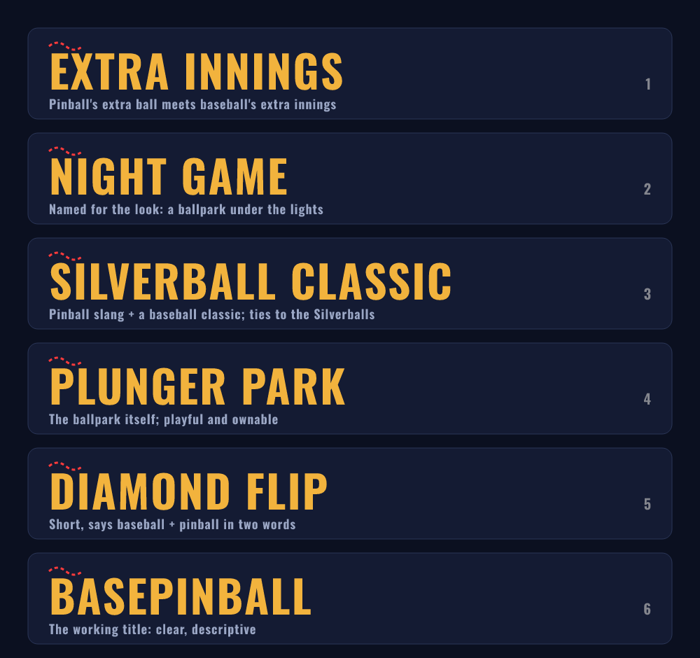

# Naming

> **Decided (2026-10-11): the game is called _Rally Ball_.** It is named for its signature
> mechanic: keep the ball live and the inning stays alive. "BasePinball" remains the repository
> and project name. **Still to do before launch:** trademark, app-store and domain checks.

The candidates considered are below.

| # | Name | For | Against |
|---|------|-----|---------|
| 1 | **Extra Innings** | A double meaning: pinball's *extra ball* and baseball's *extra innings*. Short, memorable, upbeat. | A common phrase, so the exact name may be hard to own. Needs a trademark and store search. |
| 2 | **Night Game** | Matches the art direction and the mood. Simple. | Doesn't say "pinball". Generic. |
| 3 | **Silverball Classic** | "Silverball" is classic pinball slang, and it ties to the Silverballs team | Longer. "Classic" is weak. |
| 4 | **Plunger Park** | The ballpark in the game. Playful, distinctive, likely ownable. | Reads as a place before a game |
| 5 | **Diamond Flip** | Two words, baseball plus pinball | A little abstract |
| 6 | **BasePinball** | Says exactly what it is | Functional more than evocative |

**Recommendation: Extra Innings** (or *Plunger Park* if Extra Innings turns out to be taken).

**Before locking the name:** check trademark databases, app stores and domains. None of this
has been checked. The name lives in one place in code (`src/app/brand.ts`, plus the `<title>` in
`index.html`), so changing it is a one-line edit, and the scoreboard, title screen and box score
follow it.
